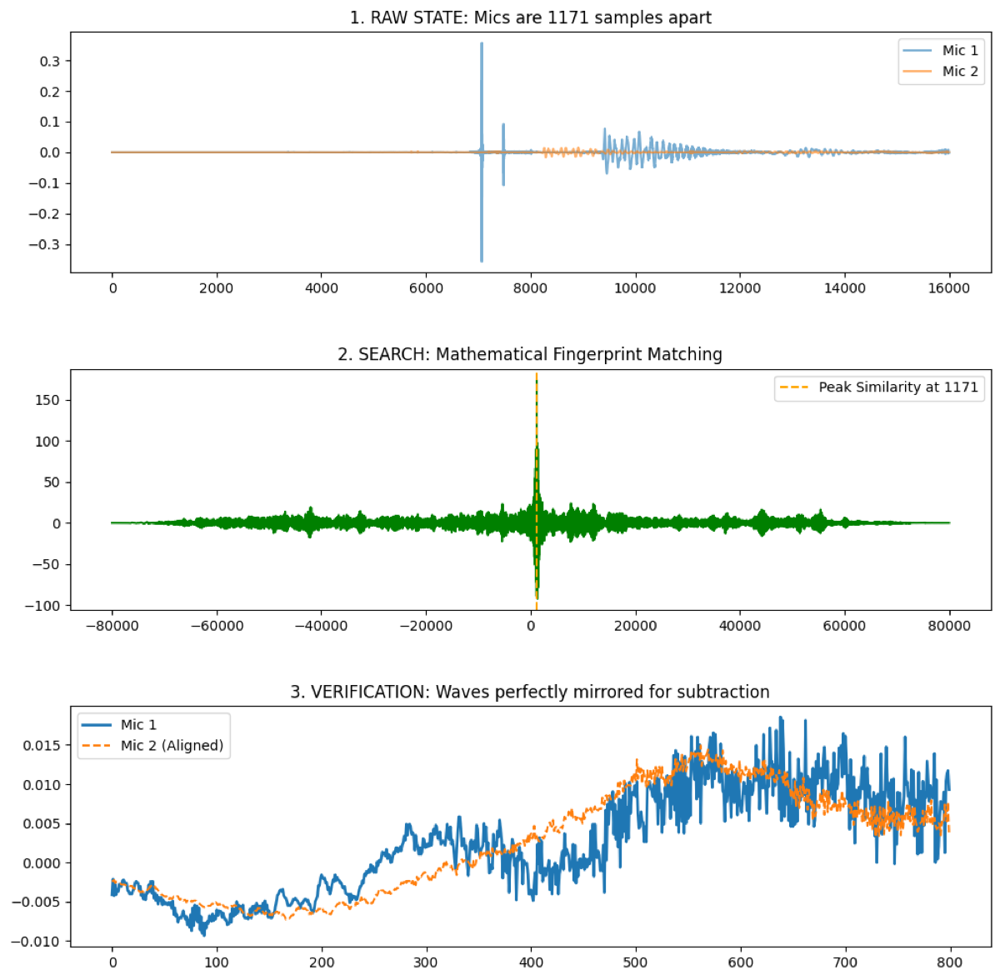
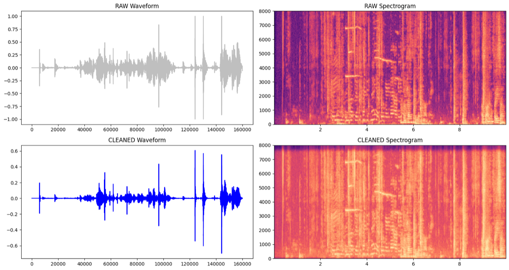
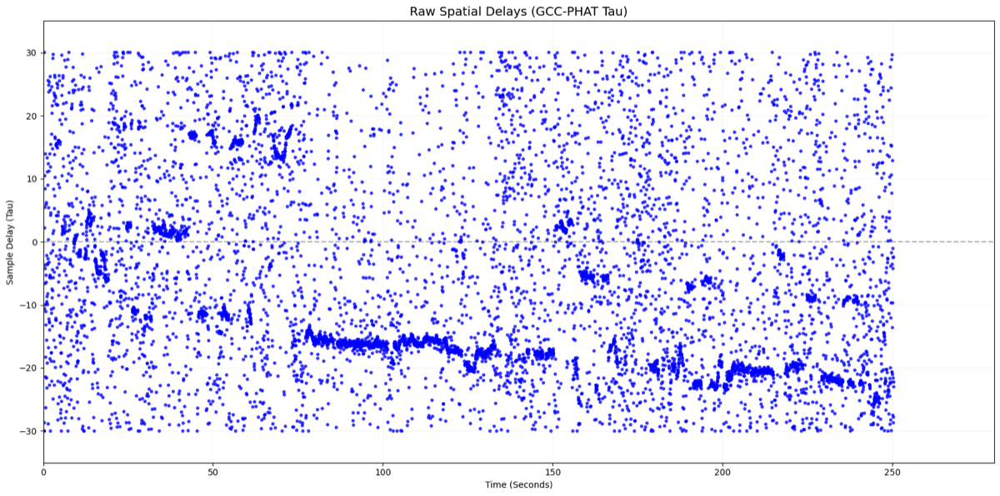
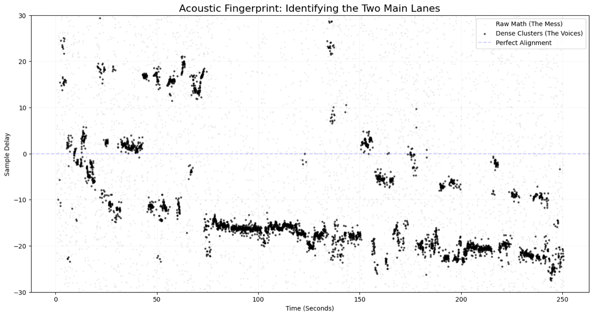
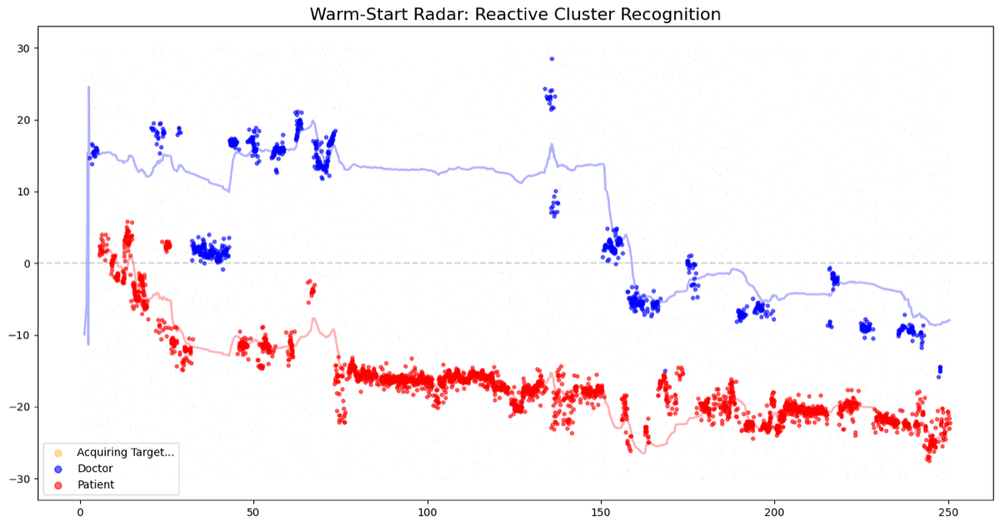
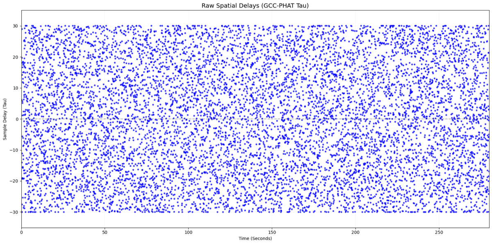

# SpeechSeperation

Separating a doctor and a patient from two microphone recordings of a clinical session with heavy crosstalk and muddy audio. Built as a take-home, on a single free-tier Colab T4, with no model training.

The short version: off-the-shelf separators failed, so I used the physics of the two-mic setup to get a model-free speaker signature, then used that signature to fix the one thing the best separator got wrong (it swaps speakers mid-session).

## The problem

Two mics, two speakers, and each mic hears both of them. A pretrained separator (MossFormer2) splits a recording into two tracks, but it does not know which track is the doctor. Worse, it swaps speakers partway through a session, so a track can start as the doctor and end as the patient.

## What I tried first, and why it failed

I like to understand a problem by running things and looking at what breaks, so I ran models before designing anything.

| Attempt | What I saw |
|---|---|
| SepFormer (mics summed, and one mic alone) | Static, robotic noise, a ghost of the other speaker, the same voice in both outputs. |
| MossFormer2 | Excellent background-noise removal, but outputs did not stick to one person. Doctor and patient flipped within a single track. |
| Align the mics by correlation, then add or subtract and re-run | Destructive interference, robotic audio. Still bad. |
| TF-GridNet, PyAnnote, DP-Mamba | Crashed on RAM. I also found no pretrained two-mic model; the available ones assume 6 or 8 mics. |

Two takeaways drove the design. Single-channel models never see the time difference between the mics, so they throw away the one piece of information that separates the speakers. And MossFormer2 is good at cleaning but weak at keeping identity.

## Approach

1. **Align and clean** (`CleanFinal.ipynb`)
   - Align the two mics by cross-correlation. Normalize first: an unnormalized correlation locks onto the loudest event and gives a wrong offset.
   - Band-pass 80 to 7500 Hz with a zero-phase filter (`sosfiltfilt`), then spectral-gate denoise in 30 s chunks so long sessions fit in memory. I used classical filters, not a neural denoiser, because I needed to preserve the phase relationship between the mics.
2. **Make the hidden structure visible** (`SeperationMossGCCPHAT.ipynb`)
   - Two mics about a foot apart see a given speaker with a small, consistent delay, on the order of 1 ms (0.3048 m / 343 m/s is about 0.9 ms, roughly 14 samples at 16 kHz). Speakers on opposite sides of the mics get different delays.
   - GCC-PHAT keeps only phase information, so it finds that delay per 30 ms window. Plotted over time, the speakers show up as separate clusters in delay space. That is a speaker signature that does not depend on any model.
   - Keep only dense clusters, since real speech holds a delay steadily while noise and echoes land at random delays.
3. **Separate with MossFormer2** (`MossFormer2_SS_16K` via ClearVoice) and plot its two tracks over time. This is where the speaker swaps become visible.
4. **Fix the swaps with the spatial signature**
   - Track each speaker's delay cluster over time, with handling for uncertain windows and re-acquisition.
   - Label the doctor and patient lanes by matching spatial hits to the loud segments of the doctor mic.
   - Re-stitch the model's two tracks by speaker identity, in short windows, and log every stitching decision. If both outputs correlate with the same lane, one is muted, since that is model leakage.

## Figures

All figures are from the working notebooks.

**1. The mics start out of sync.** Cross-correlation finds the offset (1171 samples, about 73 ms in this session), and the aligned waves overlay.

**2. Cleaning, before and after.**

**3. Raw GCC-PHAT delays over time.** Mostly noise, but two lanes are already visible.

**4. Keeping only the dense clusters.** What remains are the two speakers' delays.

**5. Lane assignment.** The tracker follows the two lanes and labels them doctor and patient.

## How I checked it

There is no clean reference recording, so I did not compute SI-SDR or WER. Instead I used the spatial signature of the raw mics as a proxy for ground truth:

- Overlay the clusters found in each separated track on the raw clusters, to confirm each track follows one speaker.
- Compare the final stitched tracks against the reference mic and check that each reproduces its speaker's cluster.
- Audit the stitch log around swap points, and listen to the results.

This shows the speakers are assigned consistently. It does not measure how clean the audio is, and I did not claim a score. A lot of the evaluation was listening to the places where plots and ears disagreed.

## What did not work

- **Sessions 1 and 8 are outliers.** In session 8 the GCC-PHAT plot shows no lanes at all, so the phase information was lost, possibly by my preprocessing. I did not find out why.

  

- **MVDR beamforming never worked for me**, even though GCC-PHAT confirmed a real delay. I could not tell whether it was a bug, clock drift between the mics, or my misunderstanding. A combination of MVDR and GCC-PHAT is what I would try next.
- **Stitching is imperfect.** Short mid-speech backchannels ("mhm") are drowned out in the delay plot, and the 40 ms windows leave occasional pops where clips are rejoined.
- **Choosing which lane is the doctor** uses a loudness and speech-length heuristic. It worked on these sessions, but speech-to-text on doctor-typical phrases would be sturdier.
- **The clustering and stitching parameters were tuned by hand** across the ten sessions, by trial and error. With ground truth I would learn this step instead.

## What I would do with more data and compute

Feed the GCC-PHAT delay maps into the separator alongside the audio (for example a TF-GridNet or MossFormer variant), so the model sees the spatial information that the single-channel models cannot. I only had a free-tier GPU and no labeled two-mic data, so I used the model as a black box and put the physics around it.

## Constraints

- One free-tier Colab T4 and a short time window.
- No training. A pretrained separator plus classical signal processing (cross-correlation, GCC-PHAT, spectral gating).
- Chunked processing so full sessions stay inside memory.

## How to run

This was done in Google Colab.

1. Run `CleanFinal.ipynb` first. It aligns and cleans each session and writes the cleaned tracks next to the originals.
2. Run `SeperationMossGCCPHAT.ipynb` to separate and stitch. Check the paths first.
3. Look at the plots and listen to the results to judge performance.

## References

- Spatial separation for multi-mic setups: [arXiv 2303.07143](https://arxiv.org/abs/2303.07143), [arXiv 2001.00391](https://arxiv.org/abs/2001.00391)

## Links

- Final file outputs: https://drive.google.com/drive/folders/1p_aHhCnaAOh-WF44XcDvW8O5Q6yR7lm7?usp=sharing
- Documented approach (my full write-up): https://docs.google.com/document/d/1_Gf_Am9_mbLGb_6pU4k5W8aXivyETiJy5yYzAO3mOu8/edit?usp=sharing
- Other files and tests: https://drive.google.com/drive/folders/16e63VQsayBiQuDbwyuxtAFa3qFGL69gT?usp=sharing
